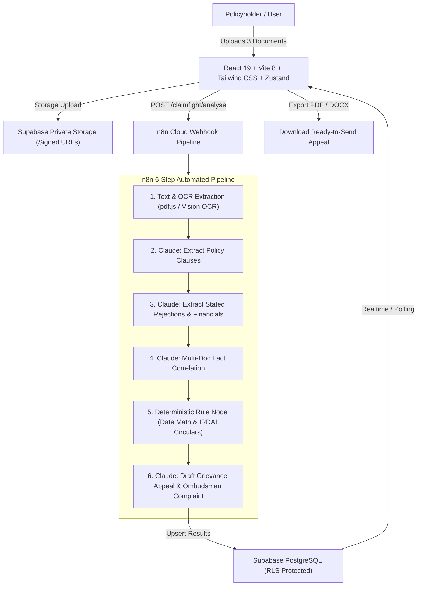

# ClaimFight 🛡️🇮🇳

> **Fight Unfair Health Insurance Rejections with AI & IRDAI Rules**
> An end-to-end, deployable web application that helps Indian families verify whether a rejected or partly paid health insurance claim was rejected fairly, flags legal grounds to contest, and drafts the Grievance Appeal and Insurance Ombudsman complaint.

Built for hackathon demonstration with a production-ready, typed React + Vite codebase, Supabase database schema, n8n Cloud workflow pipeline, and versioned Claude prompts.

---

## 🌟 Key Highlights & Demo Features

- **Side-by-Side Verification Screen (Core Demo)**:
  - **Left Card: "Insurer says"**: Repudiation reason, cited clause, and quoted excerpt from the rejection letter.
  - **Right Card: "Policy says"**: Verified policy clause heading, page number, and verbatim quote under 25 words.
  - **Clinical Ground: "Medical fact"**: Extracted from hospital discharge summary.
  - **Click-to-Inspect**: Click any quoted line to open an interactive modal with yellow highlighted text and OCR confidence scores.
- **Strict Deterministic Rule Engine**:
  - Date calculations never depend solely on the LLM.
  - Recomputes active days between inception and hospitalisation (`admissionDate - policyStartDate`).
  - Verifies elapsed waiting periods against policy clauses and IRDAI regulations.
  - Enforces the **IRDAI 2024 Moratorium Period** (60 continuous months incontestability) and **IRDAI 2020 Master Circular** prohibiting room rent proportionate deductions on pharmacy, ICU, and implants.
- **Grievance Appeal & Ombudsman Complaint Drafters**:
  - Auto-drafts formal appeal to Insurer's Grievance Redressal Officer (GRO).
  - Auto-drafts Insurance Ombudsman Complaint under Rule 13 of Insurance Ombudsman Rules, 2017.
  - Highlights unknown blanks (e.g. `[Bank Account & IFSC]`) in amber; disables download until verified.
  - One-click export to **PDF (`jsPDF`)** and **Word (`docx`)**, plus Copy to Clipboard.
- **Honest Assessments**:
  - If the insurer acted within standard terms (e.g. elective cosmetic dental care), ClaimFight says so honestly and **does not** generate a futile grievance appeal.
- **Data Privacy & DPDP Act 2023 Principles**:
  - Mandatory consent checkbox before upload.
  - **24-Hour Auto-Purge**: All uploaded documents and raw OCR texts are purged after 24 hours via Supabase `pg_cron`.
  - Zero model training guarantee: User medical data is never used to train models.
  - 15-minute encrypted signed URLs only with Row Level Security (RLS).
  - Instant **"Purge All My Data Now"** button in Privacy Settings.
- **Pre-Loaded Watermarked Sample Claims**:
  - 4 realistic Indian health claim samples with downloadable watermarked PDFs (`/public/samples`):
    1. Cataract Surgery (Waiting period miscalculation)
    2. Accidental Fracture vs Pre-Existing Disease (Trauma with no causal nexus)
    3. Room Rent Proportionate Deductions (Illegal pharmacy/ICU deductions)
    4. Routine Cosmetic Dental (Insurer appears correct demonstration)
- **Multi-Language Scaffolding**:
  - English (`en`), Hindi (`hi`), and Gujarati (`gu`) via `react-i18next`.

---

## 📑 Supported Rejection Categories (Scope Limits)

To guarantee legal precision and zero hallucinations, ClaimFight supports retail individual and family floater health insurance in India for exactly four categories:

| Category | Description | Primary Regulatory Ground |
| :--- | :--- | :--- |
| **1. Waiting Period** | Initial 30-day or 1/2/3/4-year specific illness exclusion (e.g. cataract, hernia, stones) where the required duration had already elapsed. | IRDAI Waiting Period Standardisation |
| **2. Pre-Existing Disease (PED)** | Repudiation of accidental trauma claims for unrelated lifestyle conditions (e.g. fracture rejected for hypertension), or coverage over 60 months. | IRDAI Master Circular 2024 (60-Month Moratorium) & Supreme Court Precedents |
| **3. Room Rent Proportionate Deduction** | Slashed pharmacy, consumables, implants, or ICU bills contrary to regulatory safe harbors. | IRDAI Master Circular Ref: IRDAI/HLT/REG/CIR/194/07/2020 |
| **4. Daycare & Medical Necessity** | Claims denied for "insufficient 24-hour hospitalisation" for modern day-care procedures. | IRDAI Standard Day Care Procedures List |

*Any other reason is flagged as "Not yet supported" with direct links to official Ombudsman guidelines.*

---

## 🏗️ Architecture & Tech Stack



- **Frontend**: React 19, TypeScript, Vite 8, Tailwind CSS, Lucide Icons, Zustand, TanStack Query, React Hook Form, Zod, react-i18next, jsPDF, docx, canvas-confetti.
- **Backend / Automation**: n8n Cloud workflows (importable JSON in `/n8n`), Google Cloud Vision OCR, Anthropic Claude 3.5 Sonnet.
- **Database & Auth**: Supabase PostgreSQL with Row Level Security (RLS), Supabase Auth, pg_cron 24h auto-delete.
- **Hosting**: Vercel (frontend), n8n Cloud, Supabase Cloud.

---

## 🚀 Quick Start & Local Run

### Prerequisites
- Node.js v20+ or v24+
- npm v10+

### 1. Clone & Install
```bash
git clone <repo-url>
cd claimfight
npm install
```

### 2. Configure Environment Variables
Copy `.env.example` to `.env`:
```bash
cp .env.example .env
```
*(The default `.env` includes mock/demo fallback variables so the app runs immediately in interactive demo mode without requiring live external API keys!)*

### 3. Generate Sample Documents
Ensure the sample PDFs with visible `SAMPLE - NOT A REAL CLAIM` watermarks are created in `public/samples`:
```bash
node scripts/generate_sample_pdfs.js
```

### 4. Run Development Server
```bash
npm run dev
```
Open [http://localhost:5173](http://localhost:5173) in your browser.

---

## 🗄️ Supabase Database Setup

To deploy the production database schema:
1. Create a project on [Supabase Cloud](https://supabase.com).
2. Go to **SQL Editor** in your Supabase dashboard.
3. Open `supabase/schema.sql` and run the script. It provisions:
   - `profiles` table with daily quota tracking (3 analyses/day)
   - `cases` and `documents` tables
   - `extracted_text`, `clauses`, `rejection_reasons`, `comparisons`, and `letters`
   - `official_rules` table seeded with Council for Insurance Ombudsmen (CIO) and IRDAI regulations
   - `check_and_increment_quota` rate-limiting stored procedure
   - Row Level Security (RLS) policies
   - Automated hourly `pg_cron` purge function deleting data > 24 hours old.
4. Create a private Storage Bucket named `claim_documents`.

---

## 🤖 n8n Workflow Setup

1. Open your [n8n Cloud](https://n8n.io) instance.
2. Click **Add Workflow** -> **Import from File**.
3. Select `n8n/claimfight_analysis_workflow.json`.
4. Configure credentials:
   - **Anthropic API**: `ANTHROPIC_API_KEY` (Claude 3.5 Sonnet)
   - **Supabase**: `SUPABASE_URL` and `SUPABASE_SERVICE_ROLE_KEY`
5. Activate the workflow and copy the Production Webhook URL to `VITE_N8N_WEBHOOK_URL` in `.env`.

---

## 📂 Project Structure

```text
├── n8n/
│   └── claimfight_analysis_workflow.json  # Importable n8n pipeline
├── prompts/
│   ├── step2_clauses.md                   # Versioned Claude prompt for clauses
│   ├── step3_rejection.md                 # Versioned Claude prompt for rejection
│   ├── step4_verdict.md                   # Versioned Claude prompt for correlation
│   └── step6_letters.md                   # Versioned Claude prompt for letters
├── public/
│   ├── samples/                           # Watermarked sample PDFs
│   └── favicon.svg
├── scripts/
│   └── generate_sample_pdfs.js            # Sample PDF generator with watermarks
├── src/
│   ├── components/
│   │   ├── case/                          # SourceViewerModal
│   │   ├── common/                        # DropZone, VerdictBadge, TermTooltip
│   │   └── layout/                        # Navbar, Footer, DisclaimerBanner
│   ├── data/
│   │   ├── officialRules.ts               # Seeded IRDAI & CIO statutory rules
│   │   └── sampleCases.ts                 # 4 pre-built Indian claim cases
│   ├── i18n/
│   │   └── config.ts                      # English, Hindi, Gujarati translations
│   ├── pages/
│   │   ├── auth/                          # Login, Register, ForgotPassword, VerifyEmail
│   │   ├── AppealEditorPage.tsx           # Grievance letter editor + PDF/DOCX export
│   │   ├── DashboardPage.tsx              # Case list & 24h countdown
│   │   ├── HowItWorksPage.tsx             # 6-step pipeline explanation
│   │   ├── LandingPage.tsx                # Hero, problem, explainer, demo CTA
│   │   ├── NewCasePage.tsx                # 3 dropzones with client validation
│   │   ├── NextStepsPage.tsx              # 3-stage escalation roadmap
│   │   ├── OfficialSourcesPage.tsx        # Directory with "Verify at official source"
│   │   ├── OmbudsmanComplaintPage.tsx     # Rule 13 Ombudsman complaint outline
│   │   ├── PrivacyDataPage.tsx            # DPDP Act compliance & manual purge
│   │   ├── ProcessingPage.tsx             # Live pipeline progress (<60s)
│   │   ├── ResultPage.tsx                 # Core side-by-side verification demo
│   │   └── TermsPage.tsx                  # Terms of Service & disclaimer
│   ├── services/
│   │   ├── api.ts                         # State persistence & Supabase API
│   │   ├── exportService.ts               # jsPDF and docx generators
│   │   ├── n8nService.ts                  # n8n webhook caller & execution runner
│   │   ├── ruleEngine.ts                  # Deterministic date & IRDAI rule engine
│   │   └── supabase.ts                    # Supabase client setup
│   ├── store/
│   │   ├── useAuthStore.ts                # Zustand auth & DPDP consent store
│   │   └── useCaseStore.ts                # Zustand claim cases store
│   ├── types/
│   │   └── index.ts                       # Complete TypeScript declarations
│   ├── App.tsx                            # React router definition
│   ├── index.css                          # Custom styles & design tokens
│   └── main.tsx                           # Application entry point
├── supabase/
│   └── schema.sql                         # Complete PostgreSQL DDL & RLS
├── .env.example
├── DEPLOYMENT.md
├── package.json
└── vite.config.ts
```

---

## 🎨 Design System, Color Tokens & Motion

ClaimFight uses a calming, authoritative design language that instills trust in stressed policyholders.

### 1. 60-30-10 Color System
All color tokens are declared as semantic CSS custom properties in `src/index.css`:
- **60% Cream Background (`#F6F4EF`)**: Declared as `--cream`. Provides warmth, reduces visual fatigue, and replaces stark white.
- **30% Deep Ink (`#12302E`)**: Declared as `--ink`. Used for primary headings, body text, and selected pill containers.
- **7% Teal (`#1B7F7A`)**: Declared as `--teal`. The primary action color for main CTAs, active indicators, and mascot accents.
- **3% Amber (`#F2A93B`)**: Declared as `--amber`. Reserved strictly for tiny highlights, badges, and warning accents.
- **Soft Mint (`#D9EFEA`)**: Declared as `--mint`. Used for positive status tags (`strong`) and soft highlights.
- **Line Border (`#E2DED5`)**: Declared as `--line`. Soft neutral border color.
- **Surface (`#FFFFFF`)**: Declared as `--surface`. Card and input background.

### 2. Motion Configuration (`src/config/motion.ts`)
Animation timings and easings are centralized for instant tuning:
```typescript
export const MOTION = {
  durations: {
    fast: 0.15,
    base: 0.3,
    slow: 0.6,
    scan: 3.0,
    gauge: 1.4,
  },
  easings: {
    easeOutCubic: [0.22, 1, 0.36, 1],
    easeInOut: [0.4, 0, 0.2, 1],
    spring: { type: 'spring', stiffness: 380, damping: 28 },
  },
};
```

### 3. Accessibility & `prefers-reduced-motion`
ClaimFight fully complies with WCAG accessibility guidelines. When `prefers-reduced-motion: reduce` is detected via `prefersReducedMotion()` or OS settings:
- Animated mascot floating and eye-blinking transitions default to static states.
- Page slide transitions snap instantly without layout shifts.
- Progress bars and laser scanners render without infinite loops.

---

## ⚖️ Legal & Regulatory Disclaimer

ClaimFight provides automated information analysis and drafting assistance based on public IRDAI guidelines and published Insurance Ombudsman decisions. **ClaimFight does not provide legal advice, legal representation, or a guarantee of claim payment.** Policyholders should verify cited clauses and dates with official sources before submitting representations.

Official Portals:
- [IRDAI Official Website](https://irdai.gov.in)
- [IRDAI Bima Bharosa Grievance Portal](https://bimabharosa.irdai.gov.in)
- [Council for Insurance Ombudsmen (CIO)](https://www.cioins.co.in)
